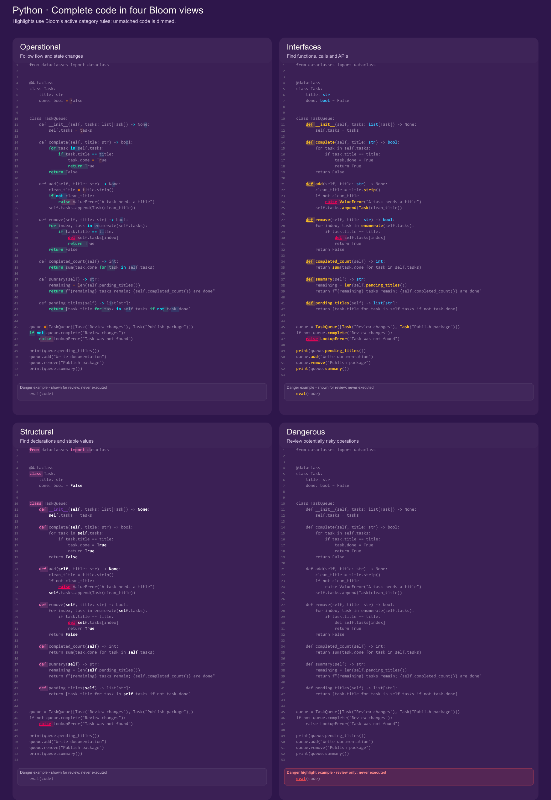
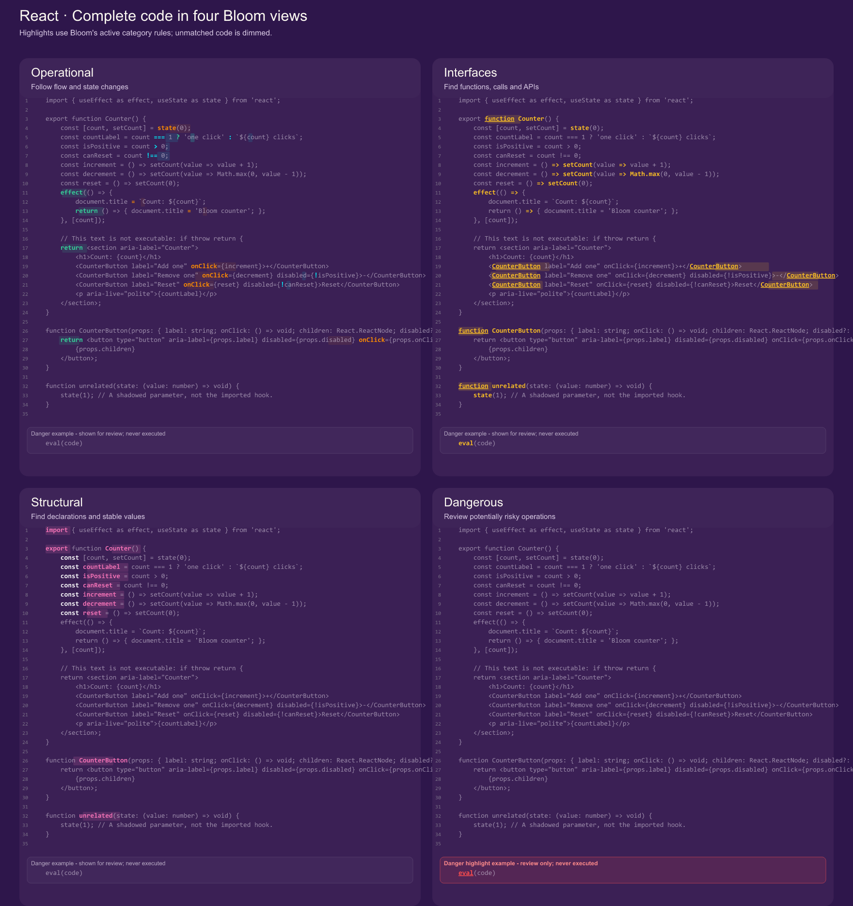

# Bloom examples

Open these complete source files in VS Code to compare Bloom's views across languages and frameworks. Choose **Operational** to follow conditions and state changes, **Interfaces** for calls and components, **Structural** for imports and declarations, and **Dangerous** to review rule-matched risky operations. Every picture is generated from its linked source file and includes at least 30 nonblank source lines.

Framework modules that call `/api/tasks` expect that route from their host application. The CUDA, GLSL, HLSL, and Solidity samples use their language toolchains.

## Languages

| Example | What to follow |
| --- | --- |
| [C task queue](languages/task_queue.c) | Bounded storage, pointer updates, guards and output. |
| [C++ feature sample](all-features/stress_test.cpp) | Classes, templates, control flow and memory operations. |
| [C# task queue](languages/TaskQueue.cs) | Records, collection updates, guards and LINQ. |
| [Clojure task queue](languages/task_queue.clj) | Immutable maps, sequence updates and transformations. |
| [CoffeeScript task queue](languages/task_queue.coffee) | Class methods, callbacks and collection changes. |
| [CUDA vector sample](languages/vector_add.cu) | Kernel launch, device memory and guarded cleanup. |
| [D task queue](languages/task_queue.d) | Structs, loops, appender output and class methods. |
| [Dart task queue UI](frameworks/Counter.dart) | Widget composition, callbacks, async reset and mounted checks. |
| [Elixir task queue](languages/task_queue.exs) | Immutable maps, pattern matching and list updates. |
| [Erlang task queue](languages/task_queue.erl) | Recursive updates, maps, list filters and result tuples. |
| [F# task queue](languages/task_queue.fs) | Records, options, list transforms and pattern matching. |
| [GLSL color shader](languages/color.frag) | Fragment inputs, uniforms, masks and output color. |
| [Go task queue](languages/task_queue.go) | Slice updates, branching, iteration and result formatting. |
| [Groovy task queue](languages/task_queue.groovy) | Classes, closures, guards and list transforms. |
| [Haskell task queue](languages/task_queue.hs) | Pure transforms, `Maybe`, records and IO. |
| [HLSL color shader](languages/color.hlsl) | Pixel inputs, constant buffers and output values. |
| [Java task queue](languages/TaskQueue.java) | Records, mutable collections and stream pipelines. |
| [JavaScript feature sample](all-features/stress_test.js) | Functions, callbacks, branches and event APIs. |
| [Julia task queue](languages/task_queue.jl) | Mutable structs, array updates and comprehensions. |
| [Kotlin task queue](languages/TaskQueue.kt) | Data classes, collection updates and lambdas. |
| [Common Lisp task queue](languages/task_queue.lisp) | Structures, vectors, higher-order functions and mutation. |
| [Lua task queue](languages/task_queue.lua) | Metatables, table updates, loops and output. |
| [MATLAB task queue](languages/task_queue.m) | Struct arrays, local functions and guarded updates. |
| [Objective-C task queue](languages/TaskQueue.m) | Foundation collections, selectors and mutation. |
| [Objective-C++ task queue](languages/TaskQueue.mm) | Objective-C messages and C++ compatible source. |
| [OCaml task queue](languages/task_queue.ml) | Immutable records, options and list transforms. |
| [Perl task queue](languages/task_queue.pl) | Hash references, loops, guards and list filters. |
| [PHP feature sample](all-features/stress_test.php) | Methods, arrays, conditions and runtime calls. |
| [PowerShell task queue](languages/task_queue.ps1) | Functions, objects, pipeline filters and updates. |
| [Python task queue](languages/task_queue.py) | Classes, loops, guards, mutations and comprehensions. |
| [R task queue](languages/task_queue.R) | Lists, closures, filters and result summaries. |
| [Ruby task queue](all-features/stress_test.rb) | Blocks, methods, conditions and system calls. |
| [Rust task queue](languages/task_queue.rs) | Mutable borrowing, `Result`, iterator filters and early return. |
| [Scala task queue](languages/TaskQueue.scala) | Case classes, immutable transformations and lambdas. |
| [Scheme task queue](languages/task_queue.scm) | Recursive list updates, predicates and higher-order calls. |
| [Shell task queue](languages/task_queue.sh) | Arrays, functions, conditionals and safe output. |
| [Solidity task queue](languages/TaskQueue.sol) | Contract state, mappings, events and guarded writes. |
| [SQL task queue](languages/task_queue.sql) | Temporary tables, updates, filters and aggregates. |
| [Swift task queue](languages/TaskQueue.swift) | Value types, guarded mutations and computed properties. |
| [TypeScript feature sample](all-features/stress_test.ts) | Typed functions, guards, mutations and callbacks. |
| [Zig task queue](languages/task_queue.zig) | Allocators, array lists, error returns and pointer updates. |

## Frameworks

| Example | What to follow |
| --- | --- |
| [Flutter](frameworks/Counter.dart) | Declarative widgets around state and event callbacks. |
| [FastAPI](frameworks/fastapi/tasks.py) | Decorated routes, an async handler, a lookup guard and a state update. |
| [React](frameworks/Counter.tsx) | Imported hooks, JSX composition, an event callback and an effect. |
| [Vue](frameworks/Counter.vue) | A computed value, template branches, events and reactive state. |
| [Svelte](frameworks/Counter.svelte) | Svelte 5 runes, markup blocks, events and lifecycle setup. |
| [Express](frameworks/express/tasks.ts) | Route declarations, request handlers, a lookup guard and a write. |
| [NestJS](frameworks/nest/tasks.controller.ts) | Controller and route decorators, request validation and mutation. |
| [Angular](frameworks/angular/tasks.component.ts) | Component metadata, lifecycle setup, template binding and state. |
| [Next.js](frameworks/next/app/tasks/page.tsx) | File-convention rendering, server data access and JSX output. |
| [Nuxt](frameworks/nuxt/pages/tasks.vue) | `useFetch`, refresh actions and template loading/error branches. |
| [SvelteKit](frameworks/sveltekit/src/routes/tasks/+page.server.ts) | A server `load` handler and guarded data parsing. |
| [Astro](frameworks/astro/src/pages/tasks.astro) | Frontmatter data loading and component markup. |

Framework examples are full source modules for their components or routes. Run them in a host application for the corresponding framework; the linked language, shader, and contract files contain the full examples shown in the pictures.
